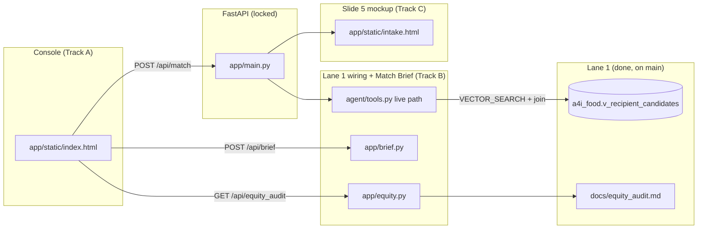

# Lane 4 Frontend Plan — Contracts, Tracks, Timeline

> Owner: Andrew (Lane 4). This file is the contract every parallel track builds against.
> If two tracks touch the same file, the decomposition was wrong. Fix it here before forking, not at merge.

---

## The shape of the repo (one picture)



---

## Decisions made (so nobody re-litigates them)

- **Design direction:** Uber-style dispatch console. Desktop first (the demo is a screen-share). Map is the hero. Cards stack beside it like ride cards.
- **Insignia baseline: not adopted.** It is an Apple-platform design-system kit (iOS/macOS tokens, 64 native components, 81 KB CSS). Craft is 15 of 100 points and the current Tailwind UI already reads as a product. Rewriting against it buys nothing judges score. We keep its two content rules we already follow: verbs on buttons, errors next to the problem.
- **Oddbunch page:** visual reference only. Not a dependency.
- **UI calls tools directly** through `/api/match` (fast, deterministic). The ADK agent produces the narrative Match Brief through `/api/brief` with a template fallback when Gemini is unreachable.
- **Voice:** every string in the UI follows the Product Voice guide in `ROADMAP.md`. Short version: "We have extra food", "Needs to go by…", "Find who can take it", "Can they keep it cold?", "Who can take it", "Who will pick it up?", "They said no? Try next pantry", "Why we skipped Greenline: no refrigerator", "Text message to send to the pantry".
- **Decided (Andrew, 11:55):** record the video on **seeded demo data** with the "Demo data" badge visible, and show one live BigQuery vector-search query in the video for the "genuinely used" point. Track B still reports what the live top 15 looks like, for the deck.

---

## Tracks and file ownership

| Track | Builds | Owns (may edit) | Must not touch |
|---|---|---|---|
| **A — Console** | Uber-style map console, 5 Milestone 4A pieces | `app/static/index.html`, `app/static/app.js`, `app/static/styles.css` | `app/main.py`, `agent/*`, `app/brief.py`, `app/equity.py` |
| **B — Lane 1 wiring + brief** | Live path queries Lane 1's view with real tract numbers; `/api/brief`; `/api/equity_audit` | `agent/tools.py` **live BigQuery block only** (inside `if project_id:`), `app/brief.py`, `app/equity.py`, `app/data/equity_audit.json`, `requirements.txt` (append only) | seeded fallback corpus, the hard filters, the composite score, `app/main.py`, `app/static/*`, `scripts/verify_traps.py` |
| **C — Intake mockup** | Slide 5 "Conversational Pantry Intake" preview | `app/static/intake.html` | everything else |
| **Locked (shared)** | | `app/main.py`, `docs/frontend_plan.md`, `ROADMAP.md`, `scripts/verify_traps.py`, `Dockerfile`, `deploy.sh` | amend here first, then fork |

**Merge order:** B, then A, then C. Integration branch off `frontend`, then fast-forward `frontend`.

**Verification at every merge:**

```bash
python -I scripts/verify_traps.py
```

plus: `uvicorn app.main:app` boots, `GET /` renders, `POST /api/match` matches the contract below, `POST /api/brief` answers without Gemini credentials (template fallback), `GET /intake` renders.

---

## Contract 1 — `POST /api/match` (live now, additive fields committed)

Request:

```json
{
  "posting_text": "10 crates of fresh spinach, harvested yesterday, needs cold storage",
  "pallets_offered": 1,
  "donor_deadline_hours": 6.0,
  "requires_cold_storage": true,
  "requires_frozen": false,
  "requires_pickup_van": true,
  "donor_lat": 41.8781,
  "donor_lon": -87.6298,
  "declined_recipient_names": []
}
```

Response (every field below is present on every call; nullable fields say so):

```json
{
  "data_source": "seeded_fallback | bigquery_live",
  "posting_summary": {
    "posting_text": "string",
    "pallets_offered": 1,
    "donor_deadline_hours": 6.0,
    "requires_cold_storage": true,
    "requires_frozen": false,
    "requires_pickup_van": true,
    "donor": { "lat": 41.8781, "lon": -87.6298 }
  },
  "clock": {
    "queried_food": "string",
    "matched_usda_product": "Lettuce (leafy greens / spinach)",
    "usda_shelf_life_hours": 168.0,
    "donor_deadline_hours": 6.0,
    "effective_window_hours": 6.0,
    "requires_refrigeration": true,
    "status": "ok | see_package | shelf_stable | not_recommended | ripeness_dependent",
    "caveat": "USDA FoodKeeper is consumer home-storage guidance, not cold-chain science."
  },
  "matches": [
    {
      "rank": 1,
      "semantic_rank": 3,
      "recipient_id": 197,
      "name": "Cedar Street Produce Alliance",
      "street": "1420 W Madison St",
      "city": "CHICAGO",
      "zip_code": "60607",
      "lat": 41.8819,
      "lon": -87.6624,
      "distance_km": 2.4,
      "cold_storage": "none | domestic | commercial | walk-in",
      "frozen_storage": false,
      "loading_dock": true,
      "refrigerated_transport": true,
      "max_pallets": 10,
      "pallets_allocated": 1,
      "pickup_window_hours": 3,
      "margin_hours": 3.0,
      "weekly_households": 600,
      "service_days": "Monday through Friday",
      "profile_text": "string (quote this in the UI)",
      "semantic_similarity": 0.89,
      "composite_score": 0.81,
      "poverty_rate": 34.2,
      "pct_no_vehicle": 28.5,
      "equity_context": { "poverty_rate": 34.2, "pct_no_vehicle": 28.5 },
      "why_them": "one sentence a human would accept",
      "draft_message": "the text message to send to the pantry"
    }
  ],
  "rejected_decoys": [
    {
      "name": "Greenline Community Pantry",
      "semantic_rank": 1,
      "lat": 41.8756,
      "lon": -87.6472,
      "reason_code": "no_cold_storage | contradiction | no_freezer | too_slow | no_vehicle | declined",
      "rejection_reason": "plain-English sentence"
    }
  ]
}
```

Rules:

- `matches` is at most 3, already sorted; `rank` is 1-based. `matches[0]` is "#1 best match", the rest are "backups".
- `rejected_decoys[].lat/lon` may be `null` on the live path if a recipient has no coordinates. The map skips null pins.
- `data_source` drives an honesty badge in the UI: "Demo data" vs "Live: BigQuery vector search".
- Track B must keep `poverty_rate`, `pct_no_vehicle` and `equity_context` populated from the view's `tract_poverty_pct` / `tract_no_vehicle_pct` on the live path. No more hard-coded 24.5 / 21.0.

### Traffic-light checks (UI derives these; no new API field)

| Light | Green when | Label (voice guide) |
|---|---|---|
| ❄️ Can they keep it cold? | `cold_storage != "none"` (and `frozen_storage` if `requires_frozen`) | "Yes, walk-in cooler" / "No refrigerator" |
| 🚐 Who will pick it up? | `refrigerated_transport == true` | "Their own van" / "Needs a volunteer driver" |
| ⏱️ Will it get there in time? | `margin_hours >= 1` green, `0 <= margin < 1` amber, `< 0` red | "3 h to spare" |
| 📍 Who it feeds | always informational | "34% of this neighbourhood lives in poverty, 29% have no car" |

---

## Contract 2 — `POST /api/brief` (Track B builds; Track A mocks until it lands)

Request: same body as `/api/match`, plus optional `"question": "string"` (one of the seven coordinator questions or free text).

Response:

```json
{
  "source": "gemini_adk | template_fallback",
  "brief": {
    "sections": [
      { "id": "primary",   "title": "Who can take it",                 "body": "markdown" },
      { "id": "why",       "title": "Why them",                        "body": "markdown" },
      { "id": "capacity",  "title": "Do they have room?",              "body": "markdown" },
      { "id": "clock",     "title": "Time left on the clock",          "body": "markdown" },
      { "id": "equity",    "title": "Who it feeds",                    "body": "markdown" },
      { "id": "message",   "title": "Text message to send",           "body": "plain text" },
      { "id": "backups",   "title": "They said no? Try next pantry",   "body": "markdown" },
      { "id": "skipped",   "title": "Why we skipped others",           "body": "markdown" }
    ]
  },
  "answer": "string or null — only when a question was asked"
}
```

Seven coordinator questions the UI offers as chips (from README):

1. Who can take 10 crates of spinach and collect before 8pm?
2. Why them and not the other pantry?
3. They said no. Who's next?
4. How long does spinach actually last?
5. Can they pick it up themselves or do we need a driver?
6. Whose neighbourhood does this help?
7. Write the pickup message.

---

## Contract 3 — `GET /api/equity_audit` (Track B builds from `docs/equity_audit.md`)

```json
{
  "metro": "Chicago",
  "metro_baseline": { "tracts": 1004, "poverty_rate": 16.96, "pct_no_vehicle": 21.89 },
  "matched_cohort": { "postings": 10, "poverty_rate": 16.39, "pct_no_vehicle": 25.75 },
  "high_need_matches": [
    { "name": "Deborahs Place", "poverty_rate": 40.2, "pct_no_vehicle": 68.1, "offer": "Prepared sandwiches and salads" }
  ],
  "postings": [
    { "n": 1, "track": "RETAIL", "offer": "string", "top_match": "string", "poverty_rate": 6.1, "pct_no_vehicle": 6.5, "cosine_distance": 0.732, "rationale": "string" }
  ],
  "honest_take": "Logistics capacity dominates for bulk produce; need dominates for prepared meals and essentials."
}
```

---

## Milestone 4A — the five things the console must show (Andrew's words)

1. **Donor Post Panel ("We have extra food")**: 1-click scenario buttons ("Grocer Spinach Call" with 6 h clock) plus simple description and deadline inputs.
2. **Live City Map**: Leaflet map showing Donor pin, Match #1 (green), Backups #2 and #3 (amber), Blocked decoys (red).
3. **Match Brief Card**: traffic-light checks (❄️ Can keep cold? 🚐 Can pick up? ⏱️ Time margin safe? 📍 Who it feeds).
4. **"They Said No" action**: `❌ They said no — Show who's next` immediately activates and displays Backup #2.
5. **Safeguard Inspector Card**: plain explanation ("Why we skipped Greenline: wants greens, but has no refrigerator").

Plus, for the judges' rigour score: a visible **data honesty strip** (which half is real, ZIP-centroid locations, FoodKeeper is consumer guidance) and the **`data_source` badge**.

---

## Andrew's timeline (only the things that need you)

Assumes a ~14:45 portal upload. Adjust if the facilitator gave a different time.

| When | You do | Who's building meanwhile |
|---|---|---|
| now → 12:05 | Approve or redline the console mockup (artifact link in chat). One message is enough. | Track B (Opus worktree) wires Lane 1's view + brief endpoint |
| 12:05 → 12:20 | **Decide: seeded demo data or live BigQuery for the recording** (see below). If live: `pip install google-cloud-bigquery`, `gcloud auth application-default login`, confirm the embedding column is populated. | Track A + C fork on approval |
| 12:20 → 12:45 | Write the 1-sentence opening scenario with Marlon. Confirm the five slides in `docs/pitch_deck_outline.md`. | Tracks building |
| 12:45 → 13:15 | Say **"merge the tracks"**. I integrate B → A → C, run verify, you click through the demo flow once locally. | — |
| 13:15 → 13:45 | `bash deploy.sh` (needs your gcloud login). Smoke the live URL on the machine you'll record from. | I fix anything the smoke test shows |
| 13:45 → 14:30 | Rehearse once out loud, then record the pitch video with Marlon. Keep a screenshot fallback. | — |
| 14:30 → 14:45 | Upload the four items to the portal. | — |

### Decision (made): seeded for the recording, one live query shown in the video

Lane 1's live audit shows the top live match for the spinach offer is **Anso Child Development** (6.1% poverty), not Cedar Street. The seeded story (Greenline decoy, Harborview contradiction, Cedar vs Maple tie) and the live data disagree.

- **Seeded (recommended unless Track B proves otherwise):** deterministic, all four traps show on screen, verify passes. Label it honestly with the "Demo data" badge and show one live BigQuery query in the video for the "vector search genuinely used" point.
- **Live:** real numbers, but the four planted traps only appear if they land in the top 15 for the query. Track B will report what the live top 15 looks like for spinach; decide after that.
